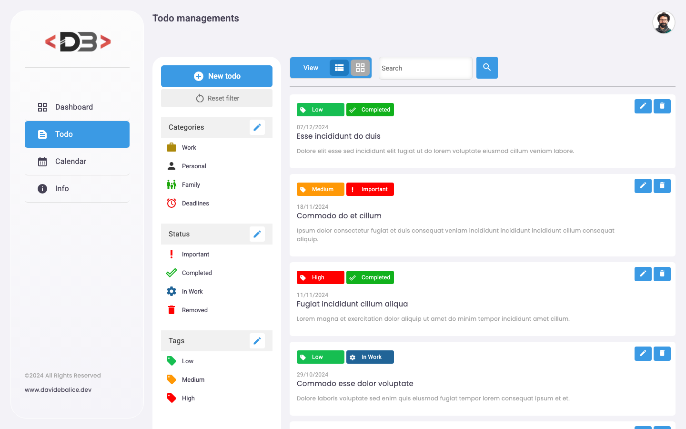
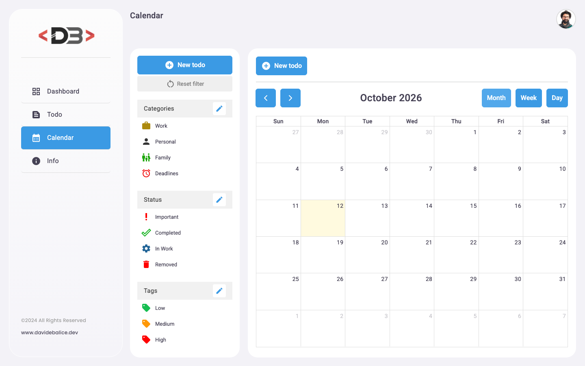

# Angular Todo App

Todo management dashboard built with Angular and Angular Material. It is the frontend of a Spring Boot REST API and lets you organise todos by category, status and tag, view them as a list, a grid or on a calendar.

**Live demo:** <https://angular-todo.davidebalice.dev>

The demo runs in read-only mode: create, update and delete operations are disabled by the backend.





## Features
- Login with JWT authentication (the token is stored in `localStorage` and sent by an HTTP interceptor)
- Dashboard with the latest todos
- Todo list with row and grid views, pagination and keyword search
- Filter todos by category, status and tag
- Create and edit todos, upload a photo for each todo
- Manage categories, statuses and tags (with icon and colour)
- Calendar view (month / week / day) powered by FullCalendar
- Route guard for the protected pages

## Tech stack
- [Angular 22](https://angular.dev/) (standalone components, lazy-loaded routes)
- [Angular Material](https://material.angular.dev/)
- [Bootstrap 5](https://getbootstrap.com/) and [ng-bootstrap](https://ng-bootstrap.github.io/)
- [FullCalendar](https://fullcalendar.io/) for the calendar view
- [RxJS](https://rxjs.dev/)
- SCSS

Backend: [spring-boot-todo-api](https://github.com/davidebalice/spring-boot-todo-api) (Spring Boot 3 REST API with JWT security).

## Getting started

### Requirements
- Node.js 22.22 / 24.15 or later (required by Angular CLI 22)
- npm
- A running instance of the [backend API](https://github.com/davidebalice/spring-boot-todo-api)

### Installation
```bash
git clone https://github.com/davidebalice/angular-todo-app.git
cd angular-todo-app
npm install
```

### Configuration
The API base URL is set in `src/app/app-config.ts`:

```ts
export const AppConfig = {
  apiUrl: 'http://localhost:8081/api/v1',
};
```

Change it to the address of your backend before building for production.

### Available scripts

| Command | Description |
| --- | --- |
| `npm start` | Start the development server on <http://localhost:4200> |
| `npm run build` | Production build in `dist/todo/browser` |
| `npm run watch` | Development build in watch mode |
| `npm test` | Run the unit tests with Vitest |

## Project structure
```
src/app/
├── calendar/       # calendar view (FullCalendar)
├── components/     # dialogs and shared components
├── dashboard/      # dashboard page
├── info/           # project info page
├── interceptors/   # API base URL and auth token interceptors
├── layouts/        # layout, sidebar and top bar
├── login/          # login page
├── model/          # TypeScript models
├── pipes/          # image and currency pipes
├── services/       # API services and auth guard
└── todos/          # todo list, editor, categories, statuses and tags
```

## Author

**Davide Balice** – [davidebalice.dev](https://www.davidebalice.dev)
